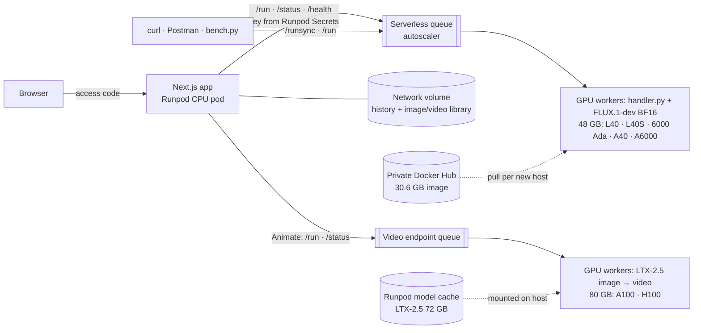

# FLUX Studio on Runpod Serverless

Text → product image with **FLUX.1-dev** on a **Runpod Serverless** GPU endpoint, plus a web app that shows,
for every request, where the time and money went (queue, cold start, GPU time, cost per image), and a second
endpoint that animates images into short clips with **LTX-2.5**.

**Live demo:** https://t2jragqmgaorlq-3000.proxy.runpod.net (generating needs the access code sent with the submission)


```bash
# One command against the live endpoint (Runpod API key needed; see Quick start for the no-key route)
curl -s -X POST https://api.runpod.ai/v2/y6hj5mx4y5b2su/runsync \
  -H "Authorization: Bearer $RUNPOD_API_KEY" -H 'Content-Type: application/json' \
  -d '{"input":{"prompt":"A studio product photo of a ceramic coffee mug on a walnut table","seed":42}}' \
  | python3 -c 'import json,sys,base64; r=json.load(sys.stdin); open("mug.png","wb").write(base64.b64decode(r["output"]["images"][0])); print(r["status"], "→ mug.png")'
```

| What the brief asked for | Where |
|---|---|
| `handler.py` that serves the model | [`workers/image/handler.py`](workers/image/handler.py), tested in [`tests/`](tests) |
| Docker image with the handler **and the model** | [`workers/image/Dockerfile`](workers/image/Dockerfile): weights baked in (33.7 GB), private `docker.io/ibrahimnd2000/flux-worker:v0.2.0` |
| Serverless endpoint on Runpod | `y6hj5mx4y5b2su`, created by [`scripts/deploy.sh`](scripts/deploy.sh) |
| Text in → image out | [examples with the exact request and Runpod's response](docs/examples) · curl · Postman · web app |

**Extras** (beyond the brief, built on top of it): measured benchmarks and a cold-start study; a hosted Next.js
app on a Runpod CPU pod (single and parallel bulk generation, live endpoint dashboards, a media library on a
network volume, beginner tooltips); a second Serverless endpoint for image → video with LTX-2.5 using Runpod
model caching (deployed; first measured clip pending, see [Video](#video-image--clip-with-ltx-25)); CI.

## Contents
[Results](#results) · [Quick start](#quick-start) · [API](#api) · [Video](#video-image--clip-with-ltx-25) ·
[Architecture](#architecture) · [Design decisions](#design-decisions) · [Platform notes](#platform-notes) ·
[Cost and business case](#cost-and-business-case) · [Limitations and next steps](#limitations-and-next-steps) ·
[Repository](#repository)

## Results

Measured on 3 Nov 2026; raw data in [`bench/results/`](bench/results), method and more detail in
[`docs/benchmarks.md`](docs/benchmarks.md).

| 1024×1024, 28 steps, BF16 | Value |
|---|---|
| Warm GPU time per image (`executionTime`) | **21.9 s p50 · 22.2 s p90** (RTX 6000 Ada, 8 jobs) · 23.8 s p50 over 21 jobs on an earlier worker |
| Queue time on a warm worker (`delayTime`) | **0.1 s** |
| End-to-end at the client | 23.9 s p50 |
| **Cost per image** | **$0.0107** (21.9 s × $1.75/h) · $0.0094 on an A40 (single sample) |
| Peak VRAM | 33.8 GB of 48 GB: no offloading needed |

| Cold start (`delayTime` of the first request) | Measured |
|---|---|
| Worker still warm (60 s idle timeout) | 0.1 s |
| FlashBoot resume of a stopped worker | **34.7 s** |
| New worker on a host that has the image cached | **93.3 s** (container → ready 15.5 s, of which model load 8.1 s) |
| New worker on a host pulling the 30.6 GB image | **690.6 s** |

<table><tr>
<td></td>
<td></td>
<td></td>
</tr></table>

*"A studio product photo of a ceramic coffee mug on a walnut table, soft morning light, shallow depth of
field", 1024², 28 steps, seeds 42–44. Request and full response for each: [`docs/examples/`](docs/examples).*

The whole build, all tests and benchmarks cost **under $1** of GPU time.

## Quick start

### 1. Try the hosted app (no setup)

| Library (images on the app's network volume) | How it works (request flow + glossary) |
|---|---|
|  |  |

Open the [live demo](https://t2jragqmgaorlq-3000.proxy.runpod.net), enter the access code, press
**Generate**. Switch to **Bulk · parallel** to send up to 8 images at once and watch the autoscaler spread them
over workers (the run summary shows the speed-up). Every image lands in the **Library**. Hover any ⓘ for a
plain-language explanation; *How it works* explains every number.

The same app API works from a terminal without a Runpod key:
```bash
curl -s -X POST https://t2jragqmgaorlq-3000.proxy.runpod.net/api/generate \
  -H 'Content-Type: application/json' -H "x-access-code: $CODE" \
  -d '{"prompt":"White running shoes on a concrete plinth","width":1024,"height":1024}'
# → {"id": "..."}; poll GET /api/jobs/<id> until "status": "COMPLETED"
```

### 2. Call the endpoint directly
```bash
cp .env.example .env    # set RUNPOD_API_KEY and RUNPOD_IMAGE_ENDPOINT_ID=y6hj5mx4y5b2su
set -a; source .env; set +a
scripts/generate.sh "A leather backpack on a wooden peg, catalogue photo" out/backpack.png
```
More (sync vs async, polling, health, error cases): [`scripts/curl_examples.md`](scripts/curl_examples.md).
**Postman:** import [`postman/runpod-flux.postman_collection.json`](postman/runpod-flux.postman_collection.json),
set `RUNPOD_API_KEY` and `ENDPOINT_ID`; *Run sync* renders the image in the response pane.

### 3. Run the worker locally (no GPU, no credits)
```bash
python3 -m venv .venv && .venv/bin/pip install -r requirements-dev.txt
.venv/bin/ruff check . && .venv/bin/pytest -q              # what CI runs

cd workers/image
MOCK_PIPELINE=1 ../../.venv/bin/python handler.py          # one job from test_input.json (SDK local mode)
MOCK_PIPELINE=1 ../../.venv/bin/python handler.py --rp_serve_api --rp_api_port 8000   # local /run, /runsync, /status
```
`MOCK_PIPELINE=1` swaps FLUX for a deterministic image generator, so validation, errors and the response shape
are testable on a laptop. The video worker works the same way (`cd workers/video && MOCK_PIPELINE=1 ...`).

### 4. Build and deploy your own
```bash
hf auth login                                   # account that accepted the FLUX.1-dev licence
REGISTRY_USER=<you> IMAGE_TAG=v0.2.0 scripts/build_and_push.sh    # linux/amd64, HF token as a BuildKit secret
runpodctl registry create ...                   # private repo → registry auth for Runpod
REGISTRY_AUTH_ID=<id> RUNPOD_API_KEY=... scripts/deploy.sh         # template + endpoint + GPU exclusions
python bench/bench.py run --label warm-1024 --n 20                 # benchmark → bench/results/*.jsonl
```

## API

**Input** (`job.input`)

| Field | Type | Default | Rules |
|---|---|---|---|
| `prompt` | string | required | non-empty, ≤ 1,000 chars |
| `width`, `height` | int | 1024 | clamped to 256–1536, rounded to a multiple of 16 |
| `num_inference_steps` | int | 28 | clamped to 1–50 |
| `guidance_scale` | float | 3.5 | clamped to 0–20 |
| `seed` | int | random | 0 – 2³²−1; the seed used is always returned |
| `num_images` | int | 1 | clamped to 1–4 (batched on one GPU) |
| `output` | `"base64"` \| `"url"` | `"base64"` | `url` uploads to S3-compatible storage (bucket env vars on the endpoint) |
| `image_format` | `"png"` \| `"jpeg"` | `"png"` | a base64 1024² PNG is ~1.34 MB; the app asks for JPEG |

Out-of-range values are clamped and listed in `notes`. Unknown fields, wrong types or an empty prompt return
`{"error": "..."}`, which Runpod reports as `status: FAILED`. `negative_prompt` is rejected on purpose:
FLUX.1-dev is guidance-distilled (no classifier-free guidance), so there is no negative branch to steer.

**Output** (a real response from the benchmark, job 2 on its worker)
```json
{
  "images": ["<base64>"],
  "seed": 1001,
  "timings": { "inference_ms": 20946.4, "encode_ms": 233.2, "total_ms": 21179.7 },
  "worker": {
    "id": "b16kombks5zagc", "gpu": "NVIDIA RTX 6000 Ada Generation",
    "vram_total_gb": 47.4, "peak_vram_gb": 33.8,
    "cold_start": false, "model_load_ms": 8107.7, "process_ready_s": 15.49, "jobs_served": 2
  },
  "params": { "width": 1024, "height": 1024, "num_inference_steps": 28, "guidance_scale": 3.5, "...": "..." }
}
```
The `worker` block is what makes cold starts and GPU placement visible per request. While a job runs,
`/status` returns `output: {"step": 14, "total_steps": 28}` from `runpod.serverless.progress_update`.

## Video: image → clip with LTX-2.5

A second Serverless endpoint (`ni76to0oacpj7o`, [`workers/video/`](workers/video)) turns an image, typically a
FLUX output, plus a motion prompt into an MP4 with audio, using Lightricks **LTX-2.5** (22B, distilled 8-step
schedule) through diffusers' `LTX2ImageToVideoPipeline`. In the app it's the **Animate** button on any image.

| Input | Default | Rules |
|---|---|---|
| `image` | required | https URL, data URI or base64; ≤ 8 MB (Runpod's `/run` limit is 10 MB) |
| `prompt` | required | the motion, e.g. "slow push-in, steam rising" |
| `resolution` | `540p` | `540p` (960×544) or `720p` (1280×704); portrait images give portrait clips |
| `num_frames` | 121 | snapped to 8k+1 within 9–241 (121 ≈ 5 s at 24 fps) |
| `fps` · `audio` · `seed` | 24 · true · random | |

Output: `video` (base64 MP4), `bytes`, `seed`, `timings`, and the same `worker` block as the image worker. The
handler refuses results over 15 MB of base64, because Runpod doesn't document a result-size limit.

**How it's deployed.** The weights are ~72 GB (transformer 38 GB, Gemma 4 text encoder 24 GB, connectors 6 GB),
far too big to bake into an image sensibly, so this endpoint uses **Runpod model caching**: the image is 8 GB
(code and dependencies only) and Runpod places the weights on hosts itself, without billing the download. The
repo is gated, so the endpoint was created in the console with the Hugging Face token as a **Runpod Secret**
(details in [Platform notes](#platform-notes) and [`scripts/deploy_video.sh`](scripts/deploy_video.sh)). GPUs:
80 GB pools (A100 $2.72/h, H100 $5.39/h). diffusers is pinned to a `main` commit (LTX-2.5 isn't in a release
yet); CI builds the image's `check` stage, which imports the real pipeline and the Gemma 4 encoder.

**Status:** deployed and verified up to the model mount. The first request was still waiting on Runpod placing
the weights when this was written; measured clip times and cost will be added here, from raw results, once it
completes. No video numbers are claimed before then.

## Architecture


Request flow, image layers and the full diagram: [`docs/architecture.md`](docs/architecture.md).

## Design decisions

**1. Serverless, not a Pod.** Creative traffic is bursty: a seller makes 20 images in ten minutes, then nothing
for hours. Serverless bills per second of worker time and scales to zero, so idle costs nothing; a Pod
bills around the clock. The trade-off is the cold start, measured above and handled in decisions 4–5.

**2. A 48 GB GPU pool, with one type excluded.** BF16 FLUX.1-dev peaks at 33.8 GB, so 48 GB cards run it
without CPU offloading. 80 GB cards would cost 1.6–3× more per hour for no benefit. The endpoint uses two pools,
`ADA_48_PRO` (L40, L40S, RTX 6000 Ada at $1.75/h) and `AMPERE_48` (A40, A6000 at $1.22/h), because L40S supply was
low and a single type left jobs queued. Lesson learned: asking for "NVIDIA L40S" selects the whole
`ADA_48_PRO` pool, which also contains an **RTX PRO 6000 Blackwell MIG slice** (sm_120). The image's PyTorch
build (CUDA 12.6) has no sm_120 kernels, so those workers failed the SDK's GPU fitness check and exited. The fix
is `gpu.excludedTypes` via the REST v2 API (runpodctl can't set it), now part of `deploy.sh`. Excluding a type
doesn't evict workers already placed; the endpoint had to be recreated.

**3. Weights baked into the image.** The brief asks for "the handler and the model" in the image, and it gives
the most predictable runtime: no Hugging Face call or token on workers (`HF_HUB_OFFLINE=1`), and the model loads
in **8.1 s** from local disk. The cost is a 30.6 GB image that each new host pulls once: **~7–10+ min**
measured. Alternatives:
- **Network volume:** small image, $0.07/GB/month, but it pins the endpoint to one data center (fewer GPUs),
  and Runpod's docs say weights load slower from a volume than from its model cache (not measured here).
- **Runpod model caching** (`--model-reference`): Runpod pre-places weights on hosts and doesn't bill the
  download. The obvious next experiment, see next steps.

Layer order (deps → weights → code) means a handler change pushes a few KB; v0.1.0 → v0.2.0 took 5 s.

**4. Workers: min 0, max 2, idle timeout 60 s, FlashBoot on.** Min 0 means no idle spend for a demo. 60 s keeps
a worker warm across a user's burst of edits (0.1 s queue instead of 35–93 s). Max 2 lets the autoscaler run
jobs in parallel (the app's bulk mode shows the speed-up) and caps the worst-case spend at about $3.50/h. For a
production interactive path I'd run **1 active worker** (always on; Runpod's pricing page offers discounts for
active workers on request) so the first request
of the day never sees a cold start, and keep the flex workers for bursts.

**5. `/run` + polling in the app, `/runsync` for scripts.** Async jobs survive multi-minute cold starts, show step
progress and keep results for ~30 min. `/runsync` (results kept ~1 min) is the simplest call for curl.

**6. Base64 by default, URLs when it matters.** A 1024² PNG is ~1.34 MB of base64 per image, fine for one image
per call. The handler can upload to S3-compatible storage (`output: "url"`) to keep payloads small for batches
and video; the app requests JPEG.

**7. Licensing.** FLUX.1-dev is **non-commercial**. For a paid product, switch to FLUX.1-schnell or another
Apache-2.0 model. The handler only needs a new `MODEL_ID`, and the brief's worked example is kept here. LTX-2.5,
planned for video, is free for commercial use under $10M annual revenue (LTX-2.x Community License).

**8. Secrets never in code, images or logs.** The HF token is a BuildKit secret and never lands in a layer. The
Runpod key and access code are Runpod Secrets on the app pod. The browser never sees the key; `.env` is gitignored.

**9. FP8.** The handler has an FP8 path (torchao `Float8WeightOnlyConfig`), but it is **not measured yet**, so no
claims here.

**10. Two endpoints, not one.** Image and video differ in GPU class (48 GB vs 80 GB), job length (seconds vs
minutes) and price per hour. Separate endpoints scale independently, so a burst of video jobs can't queue image
requests behind them, and each pays only for the GPU it needs. The app also keeps separate job stores and daily
caps for the two.

**11. Model caching for the video weights.** Baking worked well for FLUX (30.6 GB, 8.1 s model load) because the
brief asked for it and the image is pullable in minutes. At 72 GB, baking would make every new host pull ~80 GB
before its first job. Runpod model caching keeps the image at 8 GB and moves the weight download off the billed
path. The trade-off: the first placement on a host is slow and opaque (no progress API), and the endpoint has to
be created where Runpod can hold a token for the gated repo.

## Platform notes

Things found while deploying, worth knowing for anyone building on Runpod (all hit and fixed in this repo):

- **A GPU type is a pool.** `--gpu-id "NVIDIA L40S"` became pool `ADA_48_PRO`, which includes an RTX PRO 6000
  Blackwell MIG slice. Exclude incompatible types with REST v2 `gpu.excludedTypes` (`pools` and `excludedTypes`
  are replaced together). Exclusions don't evict workers already placed: they crash-looped and held the only
  worker slot until the endpoint was recreated.
- **Template changes don't replace warm workers.** After moving the template to v0.2.0, the next 21 jobs still
  ran on the warm v0.1.0 worker.
- **Status signals while a host pulls the image are misleading.** The v1 worker list showed pulling workers as
  `EXITED` and `/health` counted them `idle`/`ready`; only the worker logs told the truth. Runpod's `idle`
  workers are stopped and cached for a fast resume and are **not billed** (verified against `currentSpendPerHr`).
- **Cached models mount at `/runpod/model-store/huggingface/<org>/<name>/<revision>`** (from
  `runpodctl serverless model-status`), not the `/runpod-volume/huggingface-cache/hub` layout in the docs. The
  video handler checks both and logs what it finds.
- **A gated model reference is validated at endpoint creation.** `runpodctl serverless create --model-reference`
  fails without a token Runpod can use; the console's *Cached model* field takes a Runpod Secret.
- **Runpod's HTTP proxy is behind Cloudflare.** Next.js marks prerendered pages `s-maxage=31536000`, and
  Cloudflare served the old HTML after a deploy. The app now sends `max-age=0, must-revalidate` on pages; the
  already-cached URL could only be escaped with a new pod.
- **CPU pods don't get a pod volume** (`volumeInGb` was ignored); the app's history and library use a network
  volume instead.

## Cost and business case

**Use case:** small e-commerce sellers who need on-brand product images (and, next, 5-second social clips)
without a photo shoot.

Measured unit cost: **$0.0107 per 1024² image** of GPU execution. On top of that, each burst of activity
pays for the warm worker's idle timeout (60 s × $1.75/h ≈ $0.03) and, if cold, the model load.

| Plan: $29/month, 300 images | |
|---|---|
| GPU execution, 300 × $0.0107 | $3.21 |
| Idle timeouts, if spread over 60 sessions (estimate) | $1.75 |
| **GPU cost per subscriber** | **≈ $5**, so **~83% gross margin** before app hosting (~$0.06/h CPU pod) |

The honest risk: generation itself is a commodity. Per-image and per-second video APIs keep getting cheaper, so
the value is in what a platform like this makes easy: brand LoRAs trained on a seller's products, bundling
image + clip + copy, and data control. For Runpod, this is recurring GPU spend that follows the customer's
growth: 10,000 images a month is about **61 GPU-hours** at the measured 21.9 s per image (video multiplies that).

## Limitations and next steps
- **Video numbers:** first clip, then a small benchmark (540p/720p, 2 s/5 s) for time and $/clip, and enable
  *Animate* on the hosted app.
- **Cold-start study:** the FLUX handler with Runpod model caching instead of baked weights; compare first-request
  times on fresh hosts against the 690 s / 93 s / 35 s measured here (the video endpoint is the first data point
  for caching).
- **Blackwell-capable image:** a CUDA 12.8+ PyTorch build so the full GPU pool is usable, and a Dockerfile where
  the weights stage doesn't depend on the deps stage (today a dependency bump re-pushes 34 GB).
- **FP8 and step caching:** measure speed, quality and $/image against BF16.
- **Autoscaling policy:** load-test bursts (20–40 jobs) to tune max workers and the queue-delay threshold.
- **Production hardening:** a safety filter on prompts/images, structured metrics (queue time, cold-start rate,
  $/image per customer), alerts on `unhealthy` workers, S3 storage for the library instead of a pod volume.
- **Known demo limits:** the app's daily cap and rate limit are per pod instance; a job in flight while the app
  pod restarts is lost from the app's view (it still completes on Runpod).

## Repository
```
workers/image/     FLUX.1-dev Serverless worker: handler.py, Dockerfile (deps → check → weights → final)
workers/video/     LTX-2.5 image-to-video worker: handler.py, Dockerfile (weights via Runpod model caching)
tests/             image + video handler tests with mocked pipelines, benchmark report tests (run in CI)
bench/             bench.py (Runpod delayTime/executionTime, cost), prices.yaml, raw results
app/               Next.js 16 app: Studio, bulk, library, Animate, live endpoint dashboards; Dockerfile for a CPU pod
scripts/           build_and_push.sh, deploy.sh (image endpoint), deploy_video.sh, deploy_app.sh (app pod),
                   generate.sh, curl examples
postman/           Postman collection: image runsync/run/status/errors/health, video run/status/errors/health
docs/              architecture, benchmarks, example requests/responses, screenshots
.github/workflows  CI: ruff, pytest, hadolint + check-stage builds of both worker images, app lint/typecheck/build
```
