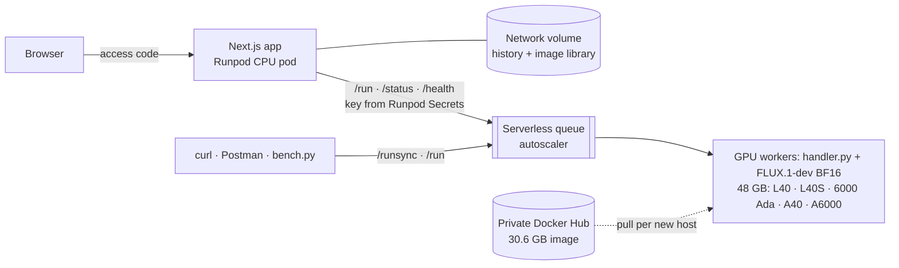

# FLUX Studio on Runpod Serverless

Text → product image with **FLUX.1-dev** on a **Runpod Serverless** GPU endpoint, plus a small web app that
shows, for every request, where the time and money went (queue, cold start, GPU time, cost per image).

**Live demo:** https://t2jragqmgaorlq-3000.proxy.runpod.net (generating needs the access code sent with the submission)


```bash
# One command against the live endpoint (Runpod API key needed; see Quick start for the no-key route)
curl -s -X POST https://api.runpod.ai/v2/y6hj5mx4y5b2su/runsync \
  -H "Authorization: Bearer $RUNPOD_API_KEY" -H 'Content-Type: application/json' \
  -d '{"input":{"prompt":"A studio product photo of a ceramic coffee mug on a walnut table","seed":42}}' \
  | python3 -c 'import json,sys,base64; r=json.load(sys.stdin); open("mug.png","wb").write(base64.b64decode(r["output"]["images"][0])); print(r["status"], "→ mug.png")'
```

| What the brief asked for | Where |
|---|---|
| `handler.py` that serves the model | [`workers/image/handler.py`](workers/image/handler.py), tested in [`tests/`](tests) |
| Docker image with the handler **and the model** | [`workers/image/Dockerfile`](workers/image/Dockerfile): weights baked in (33.7 GB), private `docker.io/ibrahimnd2000/flux-worker:v0.2.0` |
| Serverless endpoint on Runpod | `y6hj5mx4y5b2su`, created by [`scripts/deploy.sh`](scripts/deploy.sh) |
| Text in → image out | [examples with the exact request and Runpod's response](docs/examples) · curl · Postman · web app |

**Extras** (beyond the brief): measured benchmarks and cold-start study, a hosted Next.js app (single and
bulk generation, live endpoint dashboard, media library), CI. Video generation with LTX-2.5 is the next step.

## Contents
[Results](#results) · [Quick start](#quick-start) · [API](#api) · [Architecture](#architecture) ·
[Design decisions](#design-decisions) · [Cost and business case](#cost-and-business-case) ·
[Limitations and next steps](#limitations-and-next-steps) · [Repository](#repository)

## Results

Measured on 3 Nov 2026; raw data in [`bench/results/`](bench/results), method and more detail in
[`docs/benchmarks.md`](docs/benchmarks.md).

| 1024×1024, 28 steps, BF16 | Value |
|---|---|
| Warm GPU time per image (`executionTime`) | **21.9 s p50 · 22.2 s p90** (RTX 6000 Ada, 8 jobs) · 23.8 s p50 over 21 jobs on an earlier worker |
| Queue time on a warm worker (`delayTime`) | **0.1 s** |
| End-to-end at the client | 23.9 s p50 |
| **Cost per image** | **$0.0107** (21.9 s × $1.75/h) · $0.0094 on an A40 (single sample) |
| Peak VRAM | 33.8 GB of 48 GB: no offloading needed |

| Cold start (`delayTime` of the first request) | Measured |
|---|---|
| Worker still warm (60 s idle timeout) | 0.1 s |
| FlashBoot resume of a stopped worker | **34.7 s** |
| New worker on a host that has the image cached | **93.3 s** (container → ready 15.5 s, of which model load 8.1 s) |
| New worker on a host pulling the 30.6 GB image | **690.6 s** |

<table><tr>
<td></td>
<td></td>
<td></td>
</tr></table>

*"A studio product photo of a ceramic coffee mug on a walnut table, soft morning light, shallow depth of
field", 1024², 28 steps, seeds 42–44. Request and full response for each: [`docs/examples/`](docs/examples).*

The whole build, all tests and benchmarks cost **under $1** of GPU time.

## Quick start

### 1. Try the hosted app (no setup)

| Library (images on the app's network volume) | How it works (request flow + glossary) |
|---|---|
|  |  |

Open the [live demo](https://t2jragqmgaorlq-3000.proxy.runpod.net), enter the access code, press
**Generate**. Hover any ⓘ for a plain-language explanation; *How it works* explains every number.

The same app API works from a terminal without a Runpod key:
```bash
curl -s -X POST https://t2jragqmgaorlq-3000.proxy.runpod.net/api/generate \
  -H 'Content-Type: application/json' -H "x-access-code: $CODE" \
  -d '{"prompt":"White running shoes on a concrete plinth","width":1024,"height":1024}'
# → {"id": "..."}; poll GET /api/jobs/<id> until "status": "COMPLETED"
```

### 2. Call the endpoint directly
```bash
cp .env.example .env    # set RUNPOD_API_KEY and RUNPOD_IMAGE_ENDPOINT_ID=y6hj5mx4y5b2su
set -a; source .env; set +a
scripts/generate.sh "A leather backpack on a wooden peg, catalogue photo" out/backpack.png
```
More (sync vs async, polling, health, error cases): [`scripts/curl_examples.md`](scripts/curl_examples.md).
**Postman:** import [`postman/runpod-flux.postman_collection.json`](postman/runpod-flux.postman_collection.json),
set `RUNPOD_API_KEY` and `ENDPOINT_ID`; *Run sync* renders the image in the response pane.

### 3. Run the worker locally (no GPU, no credits)
```bash
python3 -m venv .venv && .venv/bin/pip install -r requirements-dev.txt
.venv/bin/ruff check . && .venv/bin/pytest -q              # what CI runs

cd workers/image
MOCK_PIPELINE=1 ../../.venv/bin/python handler.py          # one job from test_input.json (SDK local mode)
MOCK_PIPELINE=1 ../../.venv/bin/python handler.py --rp_serve_api --rp_api_port 8000   # local /run, /runsync, /status
```
`MOCK_PIPELINE=1` swaps FLUX for a deterministic image generator, so validation, errors and the response shape
are testable on a laptop.

### 4. Build and deploy your own
```bash
hf auth login                                   # account that accepted the FLUX.1-dev licence
REGISTRY_USER=<you> IMAGE_TAG=v0.2.0 scripts/build_and_push.sh    # linux/amd64, HF token as a BuildKit secret
runpodctl registry create ...                   # private repo → registry auth for Runpod
REGISTRY_AUTH_ID=<id> RUNPOD_API_KEY=... scripts/deploy.sh         # template + endpoint + GPU exclusions
python bench/bench.py run --label warm-1024 --n 20                 # benchmark → bench/results/*.jsonl
```

## API

**Input** (`job.input`)

| Field | Type | Default | Rules |
|---|---|---|---|
| `prompt` | string | required | non-empty, ≤ 1,000 chars |
| `width`, `height` | int | 1024 | clamped to 256–1536, rounded to a multiple of 16 |
| `num_inference_steps` | int | 28 | clamped to 1–50 |
| `guidance_scale` | float | 3.5 | clamped to 0–20 |
| `seed` | int | random | 0 – 2³²−1; the seed used is always returned |
| `num_images` | int | 1 | clamped to 1–4 (batched on one GPU) |
| `output` | `"base64"` \| `"url"` | `"base64"` | `url` uploads to S3-compatible storage (bucket env vars on the endpoint) |
| `image_format` | `"png"` \| `"jpeg"` | `"png"` | a base64 1024² PNG is ~1.34 MB; the app asks for JPEG |

Out-of-range values are clamped and listed in `notes`. Unknown fields, wrong types or an empty prompt return
`{"error": "..."}`, which Runpod reports as `status: FAILED`. `negative_prompt` is rejected on purpose:
FLUX.1-dev is guidance-distilled (no classifier-free guidance), so there is no negative branch to steer.

**Output** (a real response from the benchmark, job 2 on its worker)
```json
{
  "images": ["<base64>"],
  "seed": 1001,
  "timings": { "inference_ms": 20946.4, "encode_ms": 233.2, "total_ms": 21179.7 },
  "worker": {
    "id": "b16kombks5zagc", "gpu": "NVIDIA RTX 6000 Ada Generation",
    "vram_total_gb": 47.4, "peak_vram_gb": 33.8,
    "cold_start": false, "model_load_ms": 8107.7, "process_ready_s": 15.49, "jobs_served": 2
  },
  "params": { "width": 1024, "height": 1024, "num_inference_steps": 28, "guidance_scale": 3.5, "...": "..." }
}
```
The `worker` block is what makes cold starts and GPU placement visible per request. While a job runs,
`/status` returns `output: {"step": 14, "total_steps": 28}` from `runpod.serverless.progress_update`.

## Architecture


Request flow, image layers and the full diagram: [`docs/architecture.md`](docs/architecture.md).

## Design decisions

**1. Serverless, not a Pod.** Creative traffic is bursty: a seller makes 20 images in ten minutes, then nothing
for hours. Serverless bills per second of worker time and scales to zero, so idle costs nothing; a Pod
bills around the clock. The trade-off is the cold start, measured above and handled in decisions 4–5.

**2. A 48 GB GPU pool, with one type excluded.** BF16 FLUX.1-dev peaks at 33.8 GB, so 48 GB cards run it
without CPU offloading. 80 GB cards would cost 1.6–3× more per hour for no benefit. The endpoint uses two pools,
`ADA_48_PRO` (L40, L40S, RTX 6000 Ada at $1.75/h) and `AMPERE_48` (A40, A6000 at $1.22/h), because L40S supply was
low and a single type left jobs queued. Lesson learned: asking for "NVIDIA L40S" selects the whole
`ADA_48_PRO` pool, which also contains an **RTX PRO 6000 Blackwell MIG slice** (sm_120). The image's PyTorch
build (CUDA 12.6) has no sm_120 kernels, so those workers failed the SDK's GPU fitness check and exited. The fix
is `gpu.excludedTypes` via the REST v2 API (runpodctl can't set it), now part of `deploy.sh`. Excluding a type
doesn't evict workers already placed; the endpoint had to be recreated.

**3. Weights baked into the image.** The brief asks for "the handler and the model" in the image, and it gives
the most predictable runtime: no Hugging Face call or token on workers (`HF_HUB_OFFLINE=1`), and the model loads
in **8.1 s** from local disk. The cost is a 30.6 GB image that each new host pulls once: **~7–10+ min**
measured. Alternatives:
- **Network volume:** small image, $0.07/GB/month, but it pins the endpoint to one data center (fewer GPUs),
  and Runpod's docs say weights load slower from a volume than from its model cache (not measured here).
- **Runpod model caching** (`--model-reference`): Runpod pre-places weights on hosts and doesn't bill the
  download. The obvious next experiment, see next steps.

Layer order (deps → weights → code) means a handler change pushes a few KB; v0.1.0 → v0.2.0 took 5 s.

**4. Workers: min 0, max 2, idle timeout 60 s, FlashBoot on.** Min 0 means no idle spend for a demo. 60 s keeps
a worker warm across a user's burst of edits (0.1 s queue instead of 35–93 s). Max 2 lets the autoscaler run
jobs in parallel (the app's bulk mode shows the speed-up) and caps the worst-case spend at about $3.50/h. For a
production interactive path I'd run **1 active worker** (always on; Runpod's pricing page offers discounts for
active workers on request) so the first request
of the day never sees a cold start, and keep the flex workers for bursts.

**5. `/run` + polling in the app, `/runsync` for scripts.** Async jobs survive multi-minute cold starts, show step
progress and keep results for ~30 min. `/runsync` (results kept ~1 min) is the simplest call for curl.

**6. Base64 by default, URLs when it matters.** A 1024² PNG is ~1.34 MB of base64 per image, fine for one image
per call. The handler can upload to S3-compatible storage (`output: "url"`) to keep payloads small for batches
and video; the app requests JPEG.

**7. Licensing.** FLUX.1-dev is **non-commercial**. For a paid product, switch to FLUX.1-schnell or another
Apache-2.0 model. The handler only needs a new `MODEL_ID`, and the brief's worked example is kept here. LTX-2.5,
planned for video, is free for commercial use under $10M annual revenue (LTX-2.x Community License).

**8. Secrets never in code, images or logs.** The HF token is a BuildKit secret and never lands in a layer. The
Runpod key and access code are Runpod Secrets on the app pod. The browser never sees the key; `.env` is gitignored.

**9. FP8.** The handler has an FP8 path (torchao `Float8WeightOnlyConfig`), but it is **not measured yet**, so no
claims here.

## Cost and business case

**Use case:** small e-commerce sellers who need on-brand product images (and, next, 5-second social clips)
without a photo shoot.

Measured unit cost: **$0.0107 per 1024² image** of GPU execution. On top of that, each burst of activity
pays for the warm worker's idle timeout (60 s × $1.75/h ≈ $0.03) and, if cold, the model load.

| Plan: $29/month, 300 images | |
|---|---|
| GPU execution, 300 × $0.0107 | $3.21 |
| Idle timeouts, if spread over 60 sessions (estimate) | $1.75 |
| **GPU cost per subscriber** | **≈ $5**, so **~83% gross margin** before app hosting (~$0.06/h CPU pod) |

The honest risk: generation itself is a commodity. Per-image and per-second video APIs keep getting cheaper, so
the value is in what a platform like this makes easy: brand LoRAs trained on a seller's products, bundling
image + clip + copy, and data control. For Runpod, this is recurring GPU spend that follows the customer's
growth: 10,000 images a month is about **61 GPU-hours** at the measured 21.9 s per image (video multiplies that).

## Limitations and next steps
- **Video (in progress):** a second endpoint with **LTX-2.5** (image + motion prompt → 5 s clip with audio) on
  80 GB GPUs, kept separate so video load can't starve image requests; *Animate* button in the app.
- **Cold-start study:** same handler with Runpod model caching instead of baked weights; compare first-request
  times on fresh hosts against the 690 s / 93 s / 35 s measured here.
- **Blackwell-capable image:** a CUDA 12.8+ PyTorch build so the full GPU pool is usable, and a Dockerfile where
  the weights stage doesn't depend on the deps stage (today a dependency bump re-pushes 34 GB).
- **FP8 and step caching:** measure speed, quality and $/image against BF16.
- **Autoscaling policy:** load-test bursts (20–40 jobs) to tune max workers and the queue-delay threshold.
- **Production hardening:** a safety filter on prompts/images, structured metrics (queue time, cold-start rate,
  $/image per customer), alerts on `unhealthy` workers, S3 storage for the library instead of a pod volume.
- **Known demo limits:** the app's daily cap and rate limit are per pod instance; a job in flight while the app
  pod restarts is lost from the app's view (it still completes on Runpod).

## Repository
```
workers/image/     FLUX.1-dev Serverless worker: handler.py, Dockerfile (deps → check → weights → final)
tests/             handler tests with a mocked pipeline + benchmark report tests (run in CI)
bench/             bench.py (Runpod delayTime/executionTime, cost), prices.yaml, raw results
app/               Next.js 16 app: Studio, bulk, library, live endpoint dashboard; Dockerfile for a CPU pod
scripts/           build_and_push.sh, deploy.sh (endpoint), deploy_app.sh (app pod), generate.sh, curl examples
postman/           Postman collection: runsync, run, status, validation error, health
docs/              architecture, benchmarks, example requests/responses, screenshots
.github/workflows  CI: ruff, pytest, hadolint, worker image build without weights, app lint/typecheck/build
```
