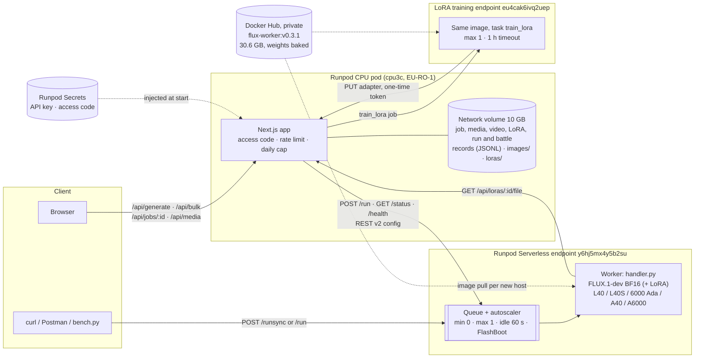
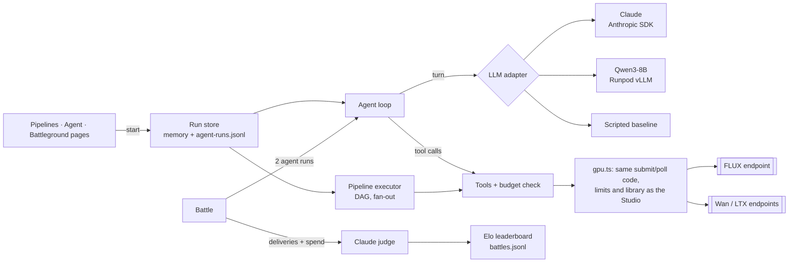

# Architecture

The [Fine-tuning](../README.md#fine-tuning-flux-loras) section of the README explains the LoRA data path.

## Request flow (one image)

1. The browser posts the prompt and access code to `/api/generate`. The Runpod API key exists only on the
   app server, injected from a Runpod Secret.
2. The app checks the code, the per-visitor rate limit and the daily cap, then calls Runpod `POST /run`.
   Async `/run` (not `/runsync`) so queue time and step progress are visible and long cold starts can't
   time out the HTTP call.
3. Runpod queues the job. If no worker is warm, the autoscaler (queue-delay rule, 4 s) starts one:
   FlashBoot resume, or a fresh container that loads the weights baked into the image.
4. `handler.py` validates the input, runs `FluxPipeline`, sends `progress_update` every second, and returns
   the image plus `timings` and a `worker` block (GPU, cold start, model load time, peak VRAM).
5. The browser polls `/api/jobs/:id`; the app proxies Runpod `/status`, prices the job from
   `executionTime × GPU $/s`, saves the image to the library on the network volume, and records the job.

## Worker image layers

`deps` (pytorch 2.14.1 / CUDA 12.6 runtime + pinned Python deps) → `weights` (33.7 GB, downloaded at build
time with the HF token as a BuildKit secret) → `final` (training deps, then `handler.py` and `lora_train.py`). A
handler change re-pushes a few KB; v0.1.0 → v0.2.0 pushed in about 5 s. A `check` stage (deps + code, no
weights) is what CI builds.

## Video endpoints (Wan 2.2, LTX-2.5)

`Animate` in the app posts a **library image id** to `/api/animate`; the app reads the image from its network
volume, sends it as a data URI to the video endpoint's `/run`, and polls `/status`. On completion the base64 MP4
from the job result is written to the library once and served from `/api/media/:id` with HTTP range support.
Jobs nobody is watching (dialog closed during a long cold start) are finished by the library's list route, so
clips still land in the library.

The video worker image is 8 GB with no weights and serves both families (`VIDEO_MODEL`): Runpod model caching
mounts the snapshot (about 34 GB for Wan 2.2, 72 GB for LTX-2.5) at
`/runpod/model-store/huggingface/<org>/<name>/<revision>`, and the handler loads it from there (`OFFLOAD=model`
keeps components on the GPU only while they run). Two endpoints: Wan 2.2 on the same 48 GB pools as FLUX (the
app's default), LTX-2.5 on 80 GB+ pools. Clips have their own daily cap in the app.

## Orchestration (pipelines, agents, battles)

Runs execute inside the app pod (`app/src/lib/agents/`), not in the browser. The browser starts a run, gets an
id, and polls `/api/runs/:id?after=<seq>` for new trace events; a run keeps going if the tab closes.

- **Budget per run:** dollars (GPU at measured or Runpod-reported cost, plus LLM tokens), images, clips, turns.
  Tools check it before submitting and reserve the estimate in the same step, so parallel tool calls can't
  overspend; a refusal is a tool error the model reads.
- **Same limits as the Studio:** agent image and video jobs go through the access code, per-visitor rate limit
  and daily caps; at most 4 runs at once and 40 per day.
- **Dry run:** GPU tools save placeholder media priced at the measured averages, so a whole flow (including the
  LLM) can be demonstrated without any GPU.
